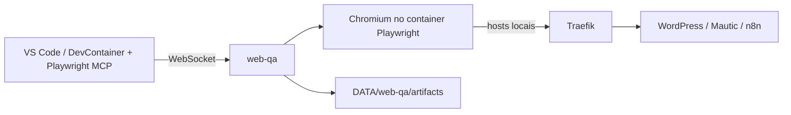

# Navegador central do Lab

`web-qa` é um serviço Playwright dedicado. Chromium e suas dependências ficam
instalados uma vez nesse container; os containers WordPress, Mautic, n8n e os
DevContainers dos projetos não recebem browser. O serviço expõe o protocolo
remoto Playwright apenas na rede interna do Lab e no loopback do host.



O MCP oferece navegação, snapshots de acessibilidade, cliques, preenchimento,
screenshots, redimensionamento e extração de conteúdo. Para testes E2E escritos
em código, Playwright conecta ao mesmo endpoint remoto. Não há API de cenários,
proxy HTTP próprio, token ou browser instalado nas aplicações.

## Instalar o serviço uma vez

Em um Lab existente, crie o serviço com os mesmos diretórios e engine usados na
instalação original:

```bash
./create-lab.sh --services web-qa
cd ~/docker-shared/web-qa
docker compose up -d --build --wait
```

Em uma nova instalação, inclua `web-qa` junto aos serviços desejados, por
exemplo `--services "wordpress mautic n8n web-qa"`. Os serviços de destino
continuam opcionais e independentes.

O Compose usa a imagem oficial Microsoft Playwright e conecta o navegador à
`infra-network`. O endpoint `ws://web-qa:3000/` não é publicado na rede externa;
`127.0.0.1:3000` existe apenas para clientes no host. Os hosts
`wordpress.<domínio>`, `mautic.<domínio>` e `n8n.<domínio>` são encaminhados ao
host do Docker/Podman, para que o browser use as rotas reais do Traefik. Quando
a porta HTTP do Lab não for 80, os exemplos incluem a porta configurada.

Screenshots, vídeos e outros artefatos dos exemplos executados no serviço ficam
em `DATA/web-qa/artifacts`. Esse diretório sobrevive a reinícios e reconstruções
do container.

## Usar no DevContainer e com agentes

Conecte o DevContainer à `infra-network` do mesmo Docker/Podman do Lab:

- Se o DevContainer usa imagem ou Dockerfile, inclua
  `"--network=infra-network"` em `runArgs` no `.devcontainer/devcontainer.json`.
- Se usa Compose, conecte o serviço de desenvolvimento à rede externa
  `infra-network`, preservando as redes que já existem.

Neste repositório, [`.vscode/mcp.json`](../.vscode/mcp.json) já configura o
Playwright MCP para conectar ao browser central. Abra o workspace dentro do
DevContainer e habilite/recarregue o servidor MCP `lab-browser`. O primeiro uso
baixa o cliente MCP no DevContainer, mas **não** baixa nem instala browsers.
Para outro workspace, copie esse arquivo e `mcp-config.json` para o projeto e
ajuste o caminho de `--config`.

O MCP inicia um processo local no DevContainer que conecta a
`ws://web-qa:3000/`. A versão do cliente está fixada em `@playwright/mcp@0.0.84`;
ela usa Playwright 1.65, compatível com o servidor Playwright 1.65.1. Ao
atualizar a versão do browser, mantenha a mesma versão major/minor no cliente.
O endpoint remoto declara também `browserName: chromium`, necessário para o
MCP selecionar o browser ao negociar a conexão WebSocket.

O agente pode usar o MCP para abrir páginas, inspecionar o snapshot, clicar,
preencher formulários, capturar screenshots, redimensionar o viewport e
extrair conteúdo. A saída automática do MCP vai para `web-qa-artifacts/` no
workspace.

## Exemplos Playwright

Os exemplos são executados dentro do serviço, então usam o mesmo browser remoto
e gravam evidências no volume persistente:

```bash
cd ~/docker-shared/web-qa
docker compose exec -T web-qa node examples/wordpress-screenshot.mjs
docker compose exec -T web-qa node examples/n8n-availability.mjs
docker compose exec -T web-qa node examples/mautic-availability.mjs
docker compose exec -T web-qa node examples/inspect-page.mjs wordpress
docker compose exec -T web-qa node examples/responsive-check.mjs wordpress
```

`inspect-page.mjs` imprime título e texto visível, além de salvar um screenshot.
`responsive-check.mjs` salva capturas em 390, 768 e 1440 pixels. Para gravar um
fluxo de login do WordPress, forneça credenciais de teste pelo ambiente:

```bash
export WP_USERNAME='usuario-de-teste'
export WP_PASSWORD='senha-de-teste'
docker compose exec -T \
  -e WP_USERNAME -e WP_PASSWORD \
  web-qa node examples/wordpress-login-video.mjs
unset WP_USERNAME WP_PASSWORD
```

O exemplo preenche e envia o formulário de login, valida o Dashboard, salva
uma captura e grava um vídeo em `DATA/web-qa/artifacts`. Não use credenciais
reais de produção.

Para scripts próprios executados no DevContainer, instale apenas a dependência
cliente no projeto (sem executar `playwright install`) e conecte usando
`chromium.connect('ws://web-qa:3000/')`. Se o script for executado via
`docker compose exec` dentro do serviço, essa dependência já está instalada.
Playwright grava vídeos no diretório informado em `recordVideo.dir`; no
container do Lab use `/artifacts`.

```text
web-qa/
├── Dockerfile
├── docker-compose.yml.in
├── package.json
├── package-lock.json
├── mcp-config.json
└── examples/
    ├── browser.mjs
    ├── wordpress-screenshot.mjs
    ├── wordpress-login-video.mjs
    ├── responsive-check.mjs
    ├── inspect-page.mjs
    ├── n8n-availability.mjs
    └── mautic-availability.mjs

DATA/web-qa/
└── artifacts/
```

O endpoint WebSocket dá controle amplo do browser e não tem autenticação; ele
fica restrito à rede interna e ao loopback do host. Use-o apenas para aplicações
de desenvolvimento confiáveis e não publique a porta 3000 em interfaces
externas.

## Playwright local, Browserless ou Playwright Server?

| Opção | Vantagens | Custos e limites |
| --- | --- | --- |
| Playwright Server oficial, adotado | Mantém browsers e dependências num único container; cliente padrão Playwright e MCP; sem API/proxy próprios; screenshots e vídeos no volume local. | O cliente precisa estar na rede do Lab; há uma única instância de browser, sem fila/gestão de concorrência. |
| Browserless em Docker | Serviço pronto para sessões WebSocket, limites e concorrência configuráveis. | Mais um produto/imagem e configuração de autenticação; exige alinhar rede, evidências e licenciamento. |
| Browserless gerenciado | Operação do browser fica com o provedor. | Requer conectividade segura do provedor até as aplicações privadas do Lab. |

Para este laboratório, o Playwright Server oficial é a menor peça que atende
tanto à automação por agente quanto a scripts E2E no DevContainer. Browserless
passa a valer a pena se houver necessidade de fila, sessões concorrentes ou
gestão centralizada de browser em maior escala.

Referências: [Playwright Docker e conexão remota](https://playwright.dev/docs/docker#remote-connection) · [Playwright MCP](https://github.com/microsoft/playwright-mcp) · [Browserless open source](https://docs.browserless.io/enterprise/open-source) · [Licenciamento Browserless](https://github.com/browserless/browserless#licensing)
